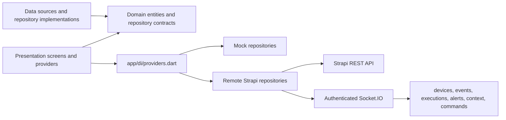

# Architecture

## Flutter app

`mobile_app/lib/main.dart` is a 17-line bootstrap. App configuration, named GoRouter routes, Riverpod DI, tokens, localization, storage, network clients, error types, and shared widgets live outside the entry point.

Each user-facing screen has its own file under `features/<feature>/presentation/screens/`. Data sources and repositories are selected in `app/di/providers.dart`; Live repositories parse the Strapi custom endpoint envelopes and Strapi v5 identifiers, while Mock repositories preserve offline demo behavior. Socket.IO events are exposed as Riverpod streams and refresh the live summary, context, timeline, and device state.

```text
mobile_app/lib/
├── app/
│   ├── app.dart
│   ├── di/providers.dart
│   └── router/{app_router,auth_guard,route_names}.dart
├── core/
│   ├── constants/  error/  network/  storage/  theme/  utils/  widgets/
├── features/
│   ├── auth/{data,domain,presentation}
│   ├── dashboard/{data,domain,presentation}
│   ├── rooms/{data,domain,presentation}
│   ├── routines/{data,domain,presentation}
│   ├── rules/{data,domain,presentation}
│   ├── timeline/{data,domain,presentation}
│   ├── explain/{data,domain,presentation}
│   ├── modes/{data,domain,presentation}
│   ├── context/{data,domain,presentation}
│   ├── conflicts/{data,domain,presentation}
│   ├── climate/{data,domain,presentation}
│   ├── energy/{data,domain,presentation}
│   ├── security/{data,domain,presentation}
│   └── settings/{data,domain,presentation}
├── l10n/{app_en,app_fr}.arb
└── main.dart
```

The architecture is being completed incrementally: older feature DTOs still include presentation types, and not every legacy literal has been migrated to design tokens/localizations. Climate adapts the selected room repository; Settings persists theme, language, and connection mode through its preferences repository.



## Backend

Strapi v5 owns persisted content types and seed roles. The integration API exposes simulator and mobile endpoints. The rule engine uses simulated timestamps, records actual/expected condition values and decisions, resolves competing actions by priority, queues commands, and records acknowledgements, retries, fallbacks, and alerts. Its active simulation state is in memory; seeded content records are persisted to SQLite.

```text
backend/src/
├── api/
│   ├── {room,device,person,context-variable,routine,rule,event,execution,override,alert,command,energy-reading}/
│   └── integration/{controllers,routes}/
├── services/
│   ├── rule-engine/{condition-evaluator,rule-evaluation,command-processor,rule-validation,runtime-store,types}.ts
│   ├── seed.ts
│   └── socket-server.ts
└── index.ts
```

The root `backend/.env.example` lists required development variables; do not commit the generated `.env` file.
